<p align="center">
  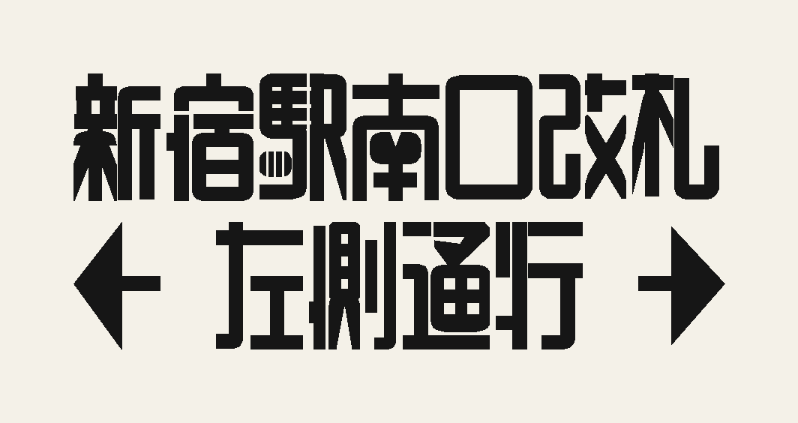
</p>

<h1 align="center">TapeFont</h1>

<p align="center">
  复刻佐藤修悦的胶带字（修悦体）：一个手搭的 TTF 字体，加一个按行计算的网页排版引擎。
</p>

---

佐藤修悦（佐藤修悦）在 JR 新宿站用黑色胶带贴出了一整套指示牌字体。他的做法是先铺等宽的胶带条，再用刀切掉多余部分：横平竖直，外弯切成圆角，断头和 T 形接口保持方角，一行里的横线互相对齐。

这个仓库做两件事：

1. **字体**：照招牌照片，一个字一个字用"胶带条"搭出来，生成 `build/hand.ttf`。
2. **引擎**：网页里每打完一行，就把这一整行一起计算：手搭的字优先，其余字从中日文笔画骨架生成；整行的横线并到共通线上，同时不压窄白缝、不缩放字、不推出字格。

> 仅供个人使用。照片版权归原作者，骨架数据的许可见 [NOTICE.md](NOTICE.md)。

## 目录

- [展示](#展示)
- [快速开始](#快速开始)
- [引擎怎么算一行](#引擎怎么算一行)
- [一个字怎么搭](#一个字怎么搭)
- [质量检查](#质量检查)
- [项目结构](#项目结构)
- [现状与限制](#现状与限制)

## 展示

### 招牌原字 vs 本字体

每组上面是从招牌照片描下来的原字，下面是本字体。原字的胶带粗细和格子比例每块招牌都不一样，本字体统一成胶带宽 0.11、格子宽高比 0.68。

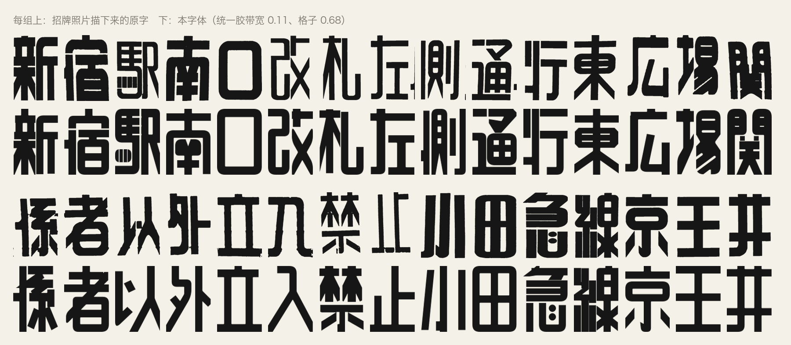

### 引擎排出的指示牌

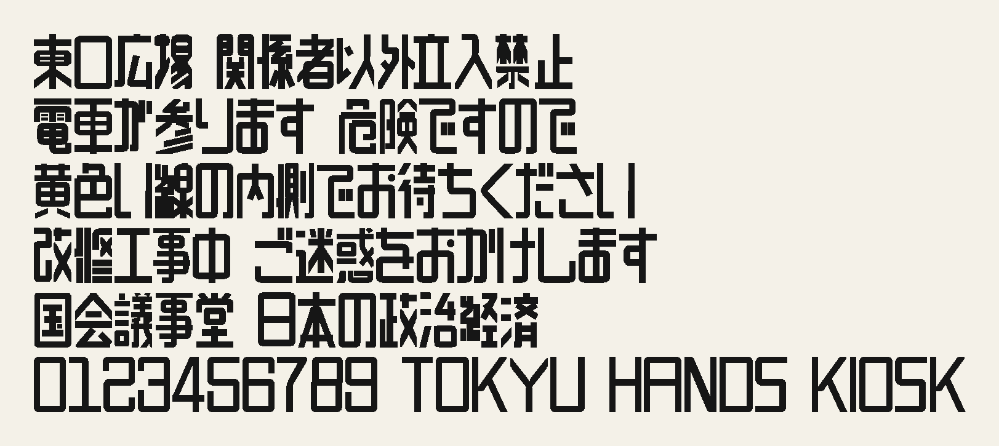

### 网页

打开 `web/index.html`，在框里打字，按回车，上一行就整体排成修悦体。可以开关整行对齐、切换中日文骨架、调字高。

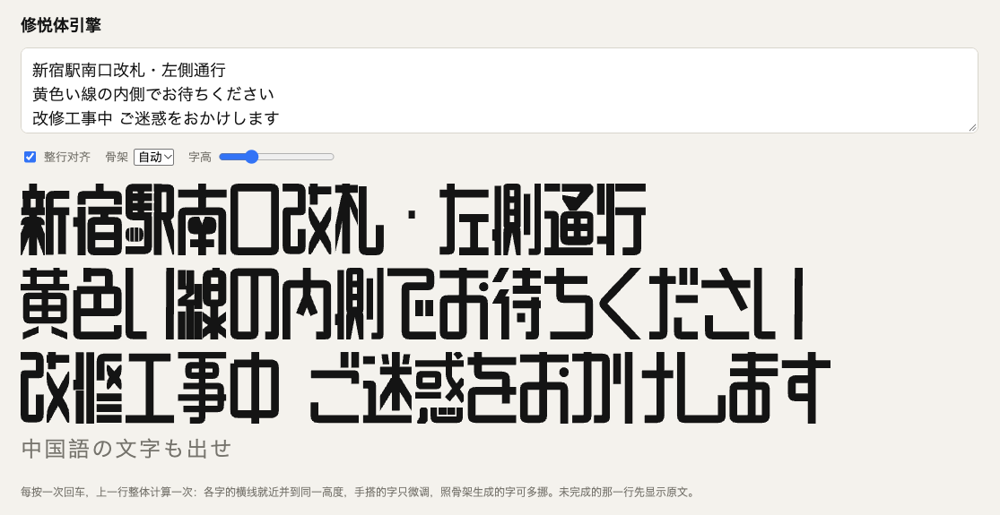

### 假名

全部平假名、片假名，含浊音、半浊音和小写假名。小写假名保持自己的小尺寸，坐在基线上。

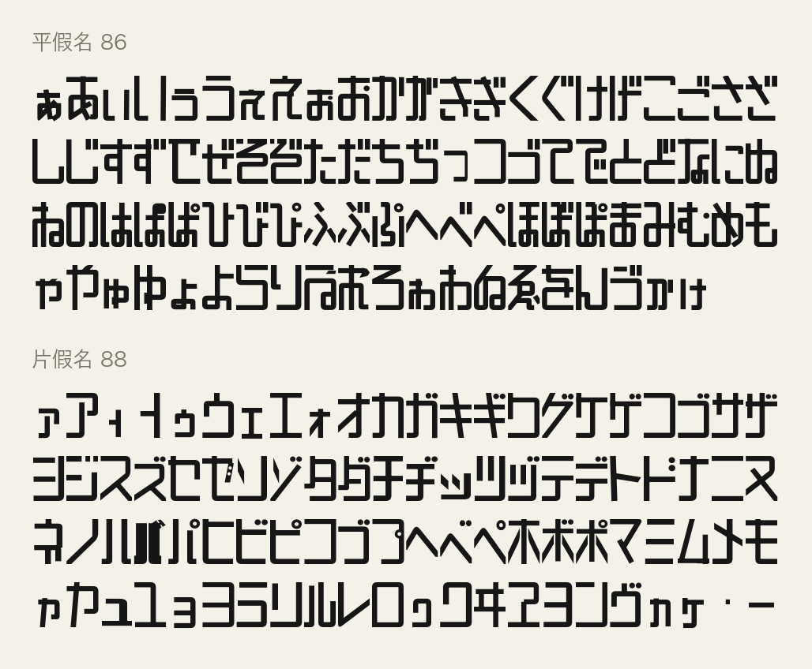

### 汉字

照招牌照片搭的汉字，加上按同一规范补搭的常用汉字。

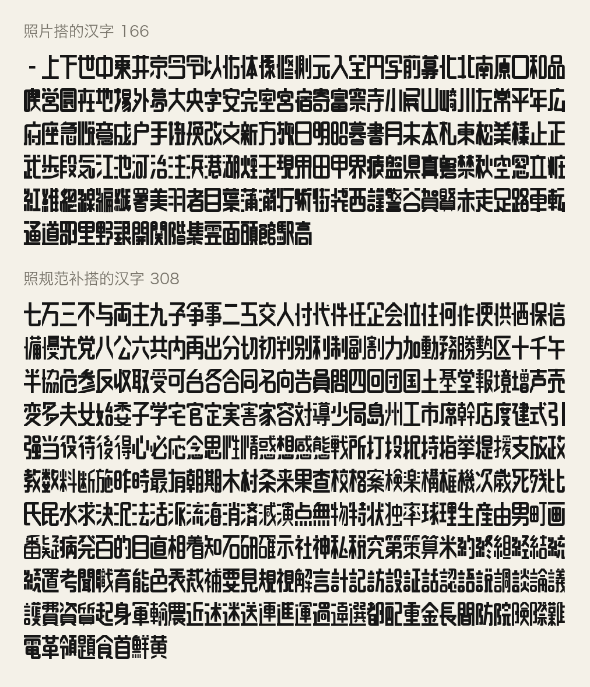

### 字母、数字、箭头

数字共用一个格子宽（0.58），中横在同一高度。

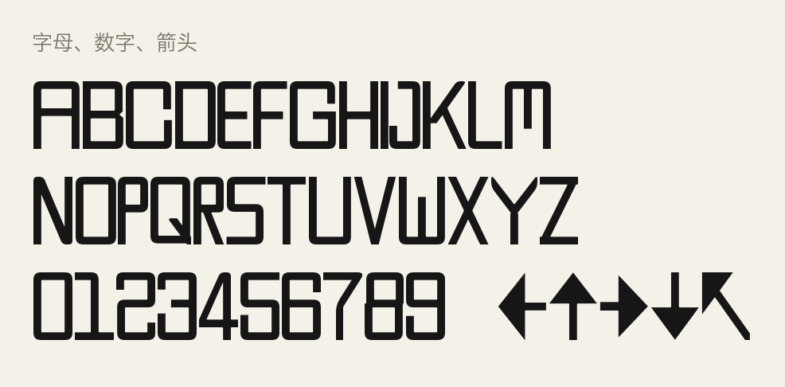

## 快速开始

需要 Python 3.12、Node 20，以及 [uv](https://github.com/astral-sh/uv)。

```bash
make venv      # 建 .venv 并装依赖（requirements.txt）
make all       # 字体 build/hand.ttf、网页数据 web/data.js、两张样张
make test      # Python 和 Node 两套测试
```

只想用：

- 字体：双击 `build/hand.ttf` 安装。
- 引擎：双击 `web/index.html`，不需要服务器。
- 命令行排版：

```bash
node web/cli.js "新宿駅南口改札|左側通行" out.json
.venv/bin/python -I src/raster_web.py out.json out.png
```

## 引擎怎么算一行

```
一行文字
  │
  ├─ 每个字取字形 ──── 有手搭字？ ── 是 → glyphs/manual/<码位>.json
  │                                  └ 否 → 按佐藤的格子生成（web/grid.js）：
  │                                         常见左偏旁（金 氵 亻 扌 木 糸 言 车 马 等 30 个）直接用手搭字里的固定搭法，其余部分在偏旁右边生成
  │                                         骨架只用来认笔画：横、竖、折、撇捺提、点、钩
  │                                         → 横归到等距的横线，竖归到等距的竖线，平行条之间至少 0.3 胶带白
  │                                         → 太挤就换细胶带（0.11 → 0.07），再挤就只留细缝（实心块加细缝）
  │                                         → 折是一条带圆弯的胶带，撇捺是一条齐切的斜条，点是方块，钩去掉或变成脚
  │
  ├─ 整行对齐 ────── 收集所有字的横线高度，相近的并成共通线
  │                  每个字：被窄白缝（不到一个胶带宽）连着的几根横算一组，整组平移
  │                  组与组之间的宽白带吸收位移，变化不超过 35%，不低于最小缝
  │                  再看相邻两字：横的上沿对上沿、下沿对下沿，错开 0.004–0.04 的，所在组在同样限制内再挪一次对齐
  │                  字不缩放，墨迹不出字格
  │
  ├─ 字距 ────────── 格子同宽；墨窄的字（く ・ 小）和邻字之间多出的白，按行平均后收回一半
  │                  两字的墨在相近的行里不近于一个字距（0.05）
  │
  └─ 画胶带 ──────── 中线 → 胶带轮廓（方头、斜接）→ 外弯圆角约 1 个胶带宽
                     补块、切口按 JSON 画；切口用遮罩挖掉
```

对齐前后的差别（红 = 对齐后才有的墨，蓝 = 对齐前才有的墨）：

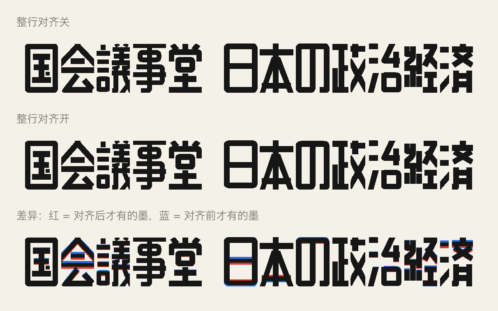

没有手搭字时，引擎按佐藤的做法从骨架结构生成：先定这个字有几条横线、几条竖线，等距铺开，再把每一笔落到线上。旧的描骨架生成器（照描笔画中线再拉直）还在，`TapeEngine.P.generator = "trace"` 或 `node web/cli.js ... --gen=trace` 切回去。

格子生成器照手搭字的几条做法：

- 假名的浊点、半浊点不进格子。字身照原样搭，右上角留给记号：平假名是两根短竖条，片假名是两个圆点，半浊点是圆环；挡路的横条往下挪或截短，竖条太靠右时字身整体往左收一点。
- 假名的勾和挑往上翻（ル レ），斜着进竖的起笔并进竖里（い），と 的起笔是半高的一横。
- 挂在横条左端的撇（广 厂）是一根竖加左脚；顶端落在横条中段的长陡撇（四）也一样。竖钩、横折钩带左钩的（刂 卩 冂）末端加左脚。
- 横条或宝盖正上方居中的点（宀 亠 言 立 文）是一根从顶边落到横条上的短竖。左边上下叠着的两三个点（氵 冫）是从格边起的短横，落在右半边最近的横线上，到右半边前留 0.3 胶带白；氵 的提照样是斜条。底下一排三个以上的点（灬）是一整条带，按点数等分，中间隔一个胶带宽的白。别处的点按自己的走向变成至少两条胶带长的短横或短竖，离指向的横竖不到一个胶带加白缝时接上去。
- 笔端离另一条线不到半条胶带才接上；接上以后封出骨架里没有的洞，就把那一处退回去（框角的接触也可以退），留出白缝；笔画少于 9 的字洞比骨架少时，反过来把停在线前的笔端接上。一笔的端头碰到另一笔的端头（框的角）时两头都接上，合成一条带圆角的胶带。
- 长笔里很短的斜段改成横或竖；斜条的切口太斜会削出细刀尖，这时换一个方向切；短于一个胶带的斜条碎片不画。撇捺的下端离格边很近时一直伸到格边，贴着格边切齐（木 的撇捺落在下面两个角上）。
- 相对的两条横线中间隔着不相对的线，白缝照样要够。框（口 日 目）里放不下白缝时先变成实心块加细缝，再减细胶带。
- 胶带不出字格：边上的笔端最多到格边。
- 佐藤的偏旁在哪个字里都一样搭。一个字的前几笔和某个偏旁的模板字（只从调参集里取）对得上，就整块照搬模板字里的偏旁，字的其余部分在偏旁右边的格子里生成。约 4000 个字用得上。

两个生成器和手搭字的差距用 `src/grid_eval.py` 量：每个有手搭字的字都从骨架生成一遍，和手搭字比 IoU、笔画覆盖、空洞数、最窄白缝，按笔画数分简单（≤8）、中等、密（16+）；随机留出 20% 的字只用来最后检验，不拿来调参。

```bash
.venv/bin/python -I src/grid_eval.py --split test --gens trace,grid --sheet   # 留出集成绩 + build/grid_compare.png
# 和旧版比：把旧版 web/*.js 拷到 DIR，加 --gens prev,grid --prev DIR（图为 手搭 | 旧 | 新）
```

| 留出集 265 字，IoU 均值（空洞数误差） | 描骨架（trace） | 格子（grid） |
|---|---|---|
| 全部 | 0.441（1.76） | 0.513（0.65） |
| 简单 122 | 0.437（0.62） | 0.527（0.25） |
| 中等 70 | 0.479（1.76） | 0.561（0.57） |
| 密 73 | 0.410（3.64） | 0.443（1.40） |

笔画多的字还偏黑，偏旁和右边部分有时贴在一起，这些字要靠继续手搭来补：

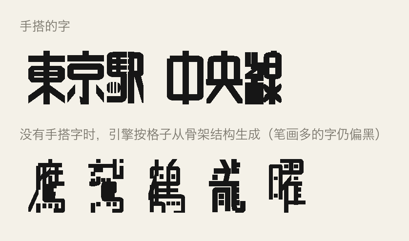

## 一个字怎么搭

每个字是一个 JSON：胶带中线（`strips`）、补块（`polys`）、切口（`cuts`）、保持方角的点（`sharp`）。坐标在字格里，x 从 0 到宽高比，y 从 0 到 1 向下。合并后外弯自动切成圆角。

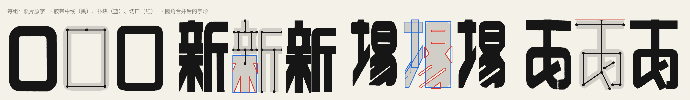

```json
{"ch": "口", "src": "口_a041_2_2.svg", "aspect": 0.68, "w": 0.11,
 "strips": [[[0.34, 0.14], [0.595, 0.14], [0.595, 0.915], [0.085, 0.915], [0.085, 0.14], [0.35, 0.14]]]}
```

规范和工具见 [docs/building_glyphs.md](docs/building_glyphs.md)，各部首和假名笔画的搭法见 [docs/radicals.md](docs/radicals.md)，佐藤本人的做法见 [docs/book_method.md](docs/book_method.md)。

## 质量检查

没有照片的字，用参考字体（冬青黑体）查完整度和辨识度：笔画和点有没有全盖到、封闭空洞数、最窄白缝。下图每组依次是：参考字体、笔画骨架、本字体、本字体叠骨架（绿 = 盖到，红 = 缺笔）。

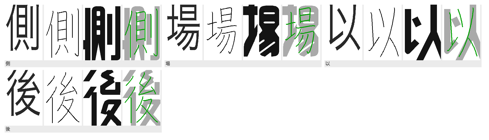

```bash
.venv/bin/python -I src/preview.py out.png "側場以後" --ja     # 完整度、空洞、最窄白缝
.venv/bin/python -I src/manual.py glyphs/manual/5834.json o.png # 和照片描字比对
.venv/bin/python -I src/review_sheet.py out_dir "一行|另一行"    # 引擎、字体、照片、逐字指标
```

## 项目结构

```
TapeFont/
├── glyphs/manual/      1402 个定稿字形（<码位>.json）；src 指向照片描字，null 表示没有照片
├── web/                引擎 engine.js、格子生成器 grid.js、页面 index.html、命令行 cli.js、导出数据 data.js
├── src/
│   ├── tape.py         字形 → build/hand.ttf
│   ├── manual.py       渲染一个字，和照片描字比对
│   ├── export_web.py   字形 + 骨架 → web/data.js
│   ├── raster_web.py   引擎输出 → PNG
│   ├── preview.py      完整度、辨识度检查
│   ├── grid_eval.py    骨架生成器对手搭字的评分
│   ├── review_sheet.py 评审对照图
│   ├── compare.py      照片描字和字体并排对比
│   ├── trace.py        从照片描字
│   ├── sample.py       样张
│   ├── showcase.py     重新生成 README 的图
│   └── data_prep/      骨架数据的整理和覆盖率统计
├── refs/
│   ├── photos_a/ photos_b/   招牌照片，来源在各自的 manifest.tsv
│   └── traced/               830 份照片描字，index.tsv 索引，photo_notes.md 每张照片的实测
├── data/               中日文笔画骨架（skeletons*.jsonl）、许可、覆盖率
├── docs/               做法、规范、部首搭法、README 图片
├── tests/              Python（字形、字体）和 Node（引擎）测试
└── build/              hand.ttf、样张
```

## 现状与限制

| 内容 | 数量 |
|---|---|
| 手搭字形 | 1402 |
| 其中照招牌照片搭的 | 297 |
| 平假名 / 片假名 | 86 / 88 |
| 汉字 | 1181 |
| 骨架覆盖 | GB2312 6763 字、JIS 第一第二水准 6355 字、常用漢字 2136 字全部覆盖 |

- 字体只收手搭字；其余字要用引擎（从骨架生成）。
- 骨架生成的字可读性不如手搭字，笔画多的字偏黑，和手搭字放在一起看得出来。
- 同一个部首，照片原字本身就有几种写法（彳、氵、人字头等），文档里都记了，新字用哪种也写明了。
- 照片来自公开报道和网络，只作参考，不随字体分发。

### 手搭到什么程度

按日文报纸用字频率（KANJIDIC2 排名）：

| 最常用的前 N 个汉字 | 已手搭 |
|---|---|
| 前 300 | 300 |
| 前 500 | 436 |
| 前 1000 | 589 |
| 前 2000 | 735 |

中文：GB2312 一级字 3755 个里手搭了 888 个。

公开统计大致是：日文最常用的约 1600 个汉字占报纸汉字的 99%；中文 2500 个常用字占 97.97%，加上 1000 个次常用字到 99.48%（《现代汉语常用字表》）。按这个算，日文报纸里约每 6 个汉字有 1 个要靠引擎生成；要让一块招牌上基本碰不到生成的字，日文还差约 1000 个，中文还差约 1600 个。

招牌用字比报纸窄得多。实际用的时候，先把要做的招牌文字排一遍，缺的字自己搭，通常几个到几十个就够了。

### 缺字自己搭

1. 找出哪些字是生成的：`.venv/bin/python -I src/review_sheet.py out_dir "要做的招牌文字"`，`out_dir/metrics.tsv` 里 source 为 skeleton 的就是生成的字。
2. 拿引擎生成的字当草稿：`node web/cli.js --glyphs 字 draft.json`，输出里就是这个字的 `strips` / `polys` / `cuts`，改好后存成 `glyphs/manual/<码位>.json`（口 → `53E3.json`）。也可以复制一个结构相近的手搭字来改。
3. 照 [docs/building_glyphs.md](docs/building_glyphs.md) 的标准改：胶带宽 0.11、格子 0.68、横线落在共通高度上、每一笔都要在。偏旁照 [docs/radicals.md](docs/radicals.md) 里同一偏旁的搭法。
4. 检查：`.venv/bin/python -I src/preview.py out.png "字" --ja` 看缺笔、空洞和最窄白缝。
5. 重建：`make font web`，字体和网页引擎都会用上新字。

## 致谢

- 佐藤修悦，以及记录他作品的 ロケットニュース24、ジモコロ 等报道。
- [Make Me a Hanzi](https://github.com/skishore/makemeahanzi)（笔画骨架，Arphic Public License）。
- [KanjiVG](https://kanjivg.tagaini.net/)（日文笔画骨架，CC BY-SA 3.0）。
- [KANJIDIC2](http://www.edrdg.org/kanjidic/)（常用漢字表，CC BY-SA 4.0）。
